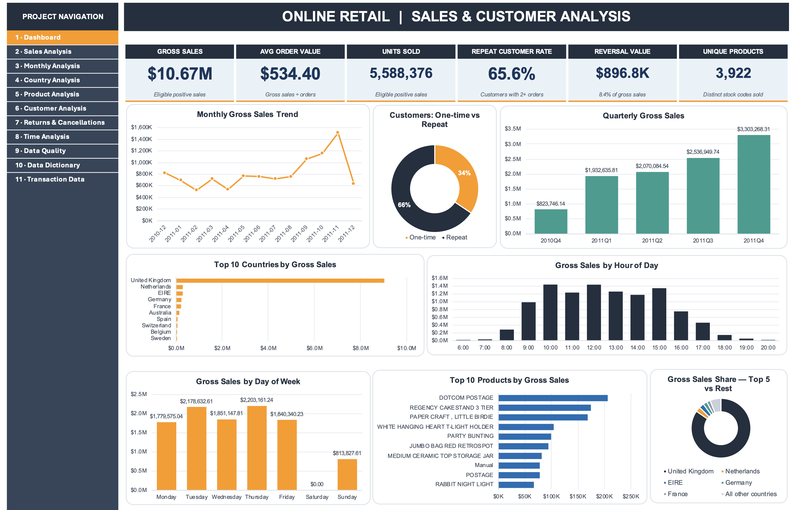
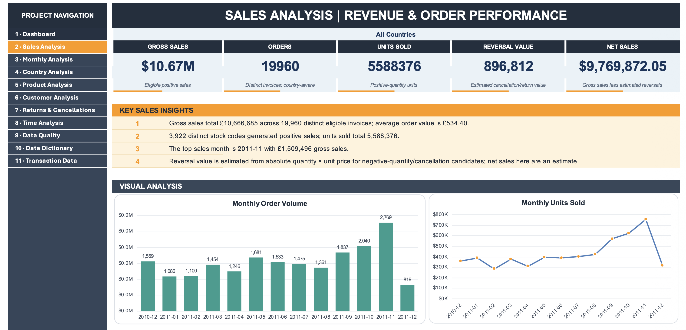

# Online Retail Sales & Customer Analysis (Excel)

An Excel analytics project exploring online retail sales, customer purchasing behaviour, product performance, country-level sales, time trends, and cancellations using the UCI Online Retail dataset.

## Dashboard Preview

*Executive dashboard summarizing key sales and customer metrics.*

## Sales Analysis

*Dedicated sales analysis page featuring KPIs, sales trends, and product and country comparisons.*

## Project Snapshot

- **Dataset size:** 541,909 source transaction records
- **Gross sales:** $10,666,684.54
- **Units sold:** 5,588,376
- **Average order value (AOV):** $534.40
- **Repeat customer rate:** 65.6%

## Key Insights

- **Seasonality:** November 2011 was the peak sales month, with approximately $1.51M in gross sales.
- **Geographic concentration:** The United Kingdom contributed 84.6% of gross sales.
- **Repeat purchasing:** 2,845 of 4,338 identified customers were repeat buyers and generated 93.1% of identified-customer sales.
- **Product mix:** The top 10 products accounted for 10.8% of gross sales, indicating sales were spread across a broad catalogue.
- **Returns and cancellations:** Estimated reversal value was approximately $896.8K, or 8.4% of gross sales.

## Project Overview

This project transforms online retail transaction data into an interactive, multi-sheet Excel analysis workbook. It combines an executive dashboard with dedicated analytical views, KPI cards, charts, business insights, data-quality checks, and metric definitions.

**Tools:** Microsoft Excel  
**Dataset:** UCI Machine Learning Repository — Online Retail  
**Source currency:** GBP (£)

## Workbook Contents

| Worksheet               | Description                                                      |
| ----------------------- | ---------------------------------------------------------------- |
| Dashboard               | Executive overview of key sales and customer metrics             |
| Sales Analysis          | Sales KPIs, monthly trends, and country/product comparisons      |
| Monthly Analysis        | Monthly and quarterly sales patterns                             |
| Country Analysis        | Country-level sales rankings and contribution                    |
| Product Analysis        | Product performance, revenue, units, and orders                  |
| Customer Analysis       | Customer purchasing patterns and leading customers               |
| Returns & Cancellations | Cancellation and reversal analysis                               |
| Time Analysis           | Sales and order patterns by day and hour                         |
| Data Quality            | Data coverage, missing values, duplicates, and validation checks |
| Data Dictionary         | KPI definitions and methodology notes                            |
| Transaction Data        | Transaction data preview                                         |

## Business Questions

- How does sales revenue change over time?
- Which countries contribute most to sales?
- Which products or stock codes perform best?
- How many orders and units are represented in eligible sales?
- What do customer purchasing and repeat-order patterns look like?
- How are cancellations and negative-quantity transactions represented?
- What data-quality limitations should be considered when interpreting results?

## Key Metrics & Methodology

- **Eligible Gross Sales:** Sum of `Quantity × UnitPrice` for eligible positive-sale transactions.
- **Total Orders:** Distinct invoice numbers among eligible positive-sale transactions.
- **Average Order Value (AOV):** Eligible gross sales divided by eligible distinct invoices.
- **Units Sold:** Total quantity across eligible positive-sale transactions.
- **Reversal Value:** An estimate based on cancellation invoices and/or negative-quantity transactions.
- **Net Sales:** Eligible gross sales less the estimated reversal value.
- **Repeat Customer Rate:** Customers with more than one eligible distinct invoice divided by customers with known customer IDs.

Cancellation invoices beginning with `C` are excluded from eligible positive sales. Missing customer IDs are excluded from customer-level distinct counts but may remain in eligible sales totals.

Exact duplicate source rows are reported rather than automatically deleted. Reversal value and net sales are analytical estimates, not audited financial figures.

## Dataset

**Source:** [UCI Machine Learning Repository — Online Retail](https://archive.ics.uci.edu/dataset/352/online+retail)

The dataset contains 541,909 transaction records covering December 2010 to December 2011. The source currency is GBP.

The workbook's Transaction Data sheet contains a 1,000-row preview; the analysis summaries are intended to use the complete source dataset.

**Dataset reference:**

Chen, D., Sain, S. L., & Guo, K. (2012). *Data mining for the online retail industry: A case study of RFM model-based customer segmentation using data mining.* Journal of Database Marketing & Customer Strategy Management, 19, 197–208.

Please review the dataset's terms and attribution guidance before redistributing the raw data.

## 🚀 How to Use

1. Download `Online Retail Sales and Customer Analysis.xlsx`.
2. Open the workbook in Microsoft Excel.
3. Start with the Dashboard for an overview of the analysis.
4. Explore the individual worksheets for deeper insights.
5. Review the Data Dictionary and Data Quality sheets before reusing the metrics.

Some formatting and navigation features are designed for Excel. Verify formulas and chart behaviour in your version of Excel before modifying the workbook.

## Limitations

- The data represents historical retail activity, not current market performance.
- December 2011 is incomplete; the dataset ends on 9 December 2011.
- Reversal value and net sales are analytical estimates.
- The source dataset does not include a dedicated product category field.
- The Transaction Data sheet is a preview rather than the complete raw dataset.

## Author

**Suraguru** | Data Analyst (Excel, SQL, Python, Power BI)

I turn operational data into clear, actionable insights using analytics and visualization tools.

[LinkedIn](https://www.linkedin.com/in/suraguru)
